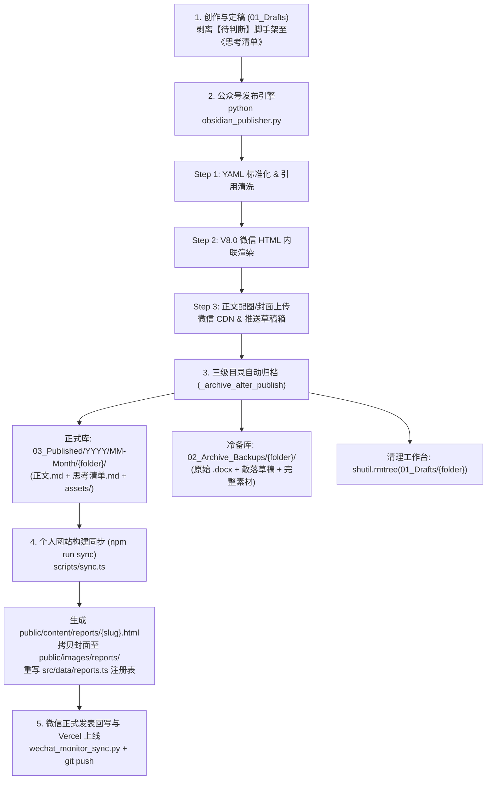

# “硅基大宗”公众号与个人网站全链路发布规范及配套代码（智能体同步手册）

> [!IMPORTANT]
> 本手册面向协作 AI 智能体（Agent），完整定义了**“硅基大宗 (Silicon Commodity)”**从 Obsidian 知识库创作、微信公众号草稿箱渲染推送、三级归档流转，到 Next.js 个人网站静态化同步与线上部署的全链路标准作业程序（SOP）及核心脚本代码。

---

## 一、 跨仓库与目录拓扑架构

整套系统由 **3 个核心本地目录** 协同驱动：

| 模块角色 | 本地绝对路径 | 核心职责 |
| :--- | :--- | :--- |
| **1. Obsidian 内容主库 (Vault)** | `F:\Documents\Vault\020_Projects\SiliconCommand` | 唯一内容源（Single Source of Truth），承载 `10_Content` 下的三级生命周期目录与 `00_Brand` 系统页 |
| **2. 公众号发布引擎仓库** | `F:\Documents\Antigravity\硅基大宗` | 存放 `obsidian_publisher.py`（V8.0 微信排版渲染、微信图床上传、草稿箱推送、三级归档流转）及 `.env` 密钥 |
| **3. 个人网站前端仓库** | `F:\Documents\Antigravity\个人网站` | Next.js 16 + Tailwind CSS 4 站点，通过 `scripts/sync.ts` 与 `scripts/wechat_monitor_sync.py` 将已发布文章构建为静态网页并通过 Git 触发 Vercel 部署 |

---

## 二、 全链路发布状态机（五步闭环流转）



---

## 三、 核心铁律与排版规范（智能体必须严格遵守）

### 1. 内容生命周期与三级目录规范 (`10_Content/`)
1. **`01_Drafts`（创作暂存区）**：
   - 严格临时态。存放未定稿 Markdown、原始 `.docx` 及临时配图。
   - 发布成功后由脚本自动执行 `shutil.rmtree` 清理，**严禁残留已发布的历史文件夹**。
2. **`03_Published`（正式发布生产区）**：
   - 永久正式库，只增不减，按 `YYYY/MM-Month/YYYY-MM-ID - 专题 - 标题/` 组织。
   - **三位一体标配**：① 剥离了 `【待判断】` 的正式 `.md`；② 独立的《`YYYY-MM-ID - 思考清单与后续选题窗口.md`》；③ `assets/` 目录（高清图表与封面图）。
   - **个人网站同步唯一扫描源**：`scripts/sync.ts` 仅扫描 `03_Published`（以及 `00_Brand`），自动忽略包含 `思考清单`、`Visual_Asset`、`Brand_Template` 的文件。
3. **`02_Archive_Backups`（历史沉淀与原始冷备区）**：
   - 版本溯源只读库，备份原始 `.docx` 原稿、思考清单与全部未选用素材。

### 2. 标准 YAML Frontmatter 协议
每篇正式发布的 Markdown 顶部必须具备以下标准属性（由 `standardize_file()` 自动补齐与排序）：
```yaml
---
topic_id: C1
publish_date: '2026-10-29'
title: 文章完整标题
author: 硅基大宗
tag: '#硬核商品'
slug: c1-custom-seo-slug-2026
description: 公众号摘要与网站 SEO 描述文案
cover: ./assets/covers/cover_main.png
cover_prompt: Cinematic, photorealistic industrial scene...
wechat_sync: true
web_sync: true
layout: paper   # 可选: 'paper' (默认标准研报) 或 'interactive' (内嵌原生 HTML 交互研报)
readTime: 12 min
---
```

### 3. 微信公众号 V8.0 排版规范
- **二级标题 (H2) 罗马数字替代**：彻底剥离 `第一部分｜`、`第1章：`、`一、` 等前缀与竖线/冒号，统一由铜金圆形徽标罗马数字（`Ⅰ`、`Ⅱ`、`Ⅲ`...）替代；`摘要/引言/要点` 不配序号；含 `硅基大宗` 或 `视角` 的 H2 渲染为独立视角卡片。
- **Callout 提示卡片与深色模式（Dark Mode）强制规范**：
  - `> [!NOTE]`、`> [!WARNING]` 等解析为扁平化卡片，剥离内部 `<blockquote>` 防止嵌套。
  - **严禁使用 `linear-gradient` 渐变背景**（微信深色模式无法反转渐变会导致白底白字隐身）。
  - 统一使用纯色 `background-color: #F4F7F9; border: 1px solid #E1E8ED; border-left: 5px solid #B87333;`，正文颜色使用 `#333333`。
- **宽表格移动端滑动适配**：外嵌 `overflow-x: auto; -webkit-overflow-scrolling: touch;`，动态计算最小保护宽度 `min-width: max(560px, 列数 * 135px)`，3列及以上右下方展示 `↔ 左右滑动查看完整表格`。
- **图注与数据来源居左**：`图*｜...`、`表*｜...`、`数据来源：...` 统一 `text-align: left; font-size: 12px; color: #888;`。
- **系列方法论标志卡片**：在“下篇预告”末尾、参考引用之前，强制保留独立卡片：
  ```markdown
  > [!NOTE]
  > **系列方法**
  > 
  > 每篇只解决一个问题：先给数据，再讲传导，最后列反证。行情会变，但框架要能留下来。
  ```

---

## 四、 标准执行指令速查表 (CLI Commands)

### 场景 A：单篇/批量发布至公众号草稿箱（自动归档 + 自动同步个人网站）
```powershell
# 工作目录：F:\Documents\Antigravity\硅基大宗
# 1. 单篇发布（最常用：自动执行 YAML标准化 -> 微信HTML渲染 -> 上传图片/封面 -> 推草稿箱 -> 三级归档 -> 触发个人网站 sync.ts）
python obsidian_publisher.py "F:\Documents\Vault\020_Projects\SiliconCommand\10_Content\01_Drafts\文件夹名\文章名.md"

# 2. 跳过标准化直接发布（当 YAML 和引用已手动精修完毕时使用）
python obsidian_publisher.py --no-standardize "F:\...\文章名.md"

# 3. 批量发布 01_Drafts 下所有草稿
python obsidian_publisher.py --batch
```

### 场景 B：个人网站研报库同步与构建部署
```powershell
# 工作目录：F:\Documents\Antigravity\个人网站
# 1. 手动触发 Obsidian (03_Published) -> 网站静态 HTML 与注册表同步
npm run sync

# 2. 扫描微信草稿箱微调后的封面、或侦测草稿箱“出库发表”自动将网站日期更新为今日
npm run sync:wechat
# 等价于：python scripts/wechat_monitor_sync.py --scan

# 3. 公众号正式群发后，传入微信公开链接一键对齐发布日期与官方封面并重新生成网站数据
python scripts/wechat_monitor_sync.py --url "https://mp.weixin.qq.com/s/xxxxxx"

# 4. 本地校验与推送到 GitHub (触发 Vercel 自动部署上线)
npm run lint
npm run build
git add src/data/reports.ts public/content/ public/images/reports/
git commit -m "content: sync published report"
git push origin main
```

---

## 五、 核心配套代码全集

### 1. 微信公众号发布与归档主引擎：`obsidian_publisher.py`
- **文件路径**：`F:\Documents\Antigravity\硅基大宗\obsidian_publisher.py`
- **环境依赖**：`pip install requests python-frontmatter markdown python-dotenv`
- **配置文件**：同目录下 `.env` 需配置 `WECHAT_APPID`、`WECHAT_APPSECRET`、`VAULT_PATH`。

```python
import sys
import re
import os

# 强制设置标准输出为 UTF-8，防止 Windows 终端报错
if hasattr(sys.stdout, 'reconfigure'):
    sys.stdout.reconfigure(encoding='utf-8')
import requests
import json
import base64
import markdown
import datetime
import time
from pathlib import Path
from urllib.parse import urlparse

# ─────────────────────────────────────────
# 1. 品牌设计系统 (V8.0 Industrial Standard)
# ─────────────────────────────────────────
C_DEEP_BLUE      = "#003366"  # 核心工业蓝
C_COPPER_GOLD    = "#B87333"  # 资产高亮金
C_TEXT_DARK      = "#1A1A2E"  # 极致深蓝黑
C_LIGHT_GREY     = "#F4F7F9"  # 背景灰
C_TERMINAL_BG    = "#1A1B26"  # 终端深色背景
C_TERMINAL_TEXT  = "#A9B1D6"  # 终端文字色
C_BORDER         = "#E1E8ED"  # 标准分割线

# 工业级字体栈：优先微软雅黑增强 PC 端权威感，兼顾移动端苹方
FONT_STACK = "'Microsoft YaHei', 'PingFang SC', -apple-system, system-ui, sans-serif"

# ─────────────────────────────────────────
# 2. 发布前标准化 (Pre-flight Standardization)
# ─────────────────────────────────────────
STANDARD_ORDER = [
    "topic_id", "publish_date", "title", "author", "tag", "slug",
    "description", "cover", "cover_prompt", "wechat_sync", "web_sync",
]

def _get_topic_id(path):
    parent_id = re.search(r'^(\d+)', Path(path).parent.name)
    if parent_id: return int(parent_id.group(1))
    file_id = re.search(r'(\d+)', Path(path).name)
    if file_id: return int(file_id.group(1))
    return 0

def _get_root_domain(url):
    try:
        domain = urlparse(url).netloc
        if domain.startswith('www.'): domain = domain[4:]
        domain = domain.split(':')[0]
        return f"https://{domain}"
    except Exception:
        return ""

def _clean_ai_citations(content):
    """清理破碎的 AI 引用块格式，替换为带 Favicon 的列表项"""
    icon_template = ''
    pattern = r'\[\s*(?:\|\s*)?\!\[.*?\]\(.*?\)\s*(?:[a-zA-Z0-9.-]+\.[a-z]{2,})\s*(.*?)\s*(?:在新窗口中打开)?\]\((.*?)\)'

    def replacer(match):
        title = re.sub(r'\s+', ' ', match.group(1).strip()).rstrip('[| \n\r')
        url = match.group(2).strip()
        root_domain = _get_root_domain(url)
        icon_tag = icon_template.format(root_domain=root_domain)
        return f"\n- {icon_tag} [{title}]({url})\n"

    new_content = re.sub(pattern, replacer, content, flags=re.DOTALL)
    new_content = re.sub(r'(\)\s*)(- ]', '', content.strip())
            desc = clean_text[:54].replace("\n", " ").strip() + "..."
        new_metadata["description"] = desc

        new_metadata["cover"] = data.get("cover") or ""

        existing_prompt = data.get("cover_prompt") or ""
        if not new_metadata["cover"] and not existing_prompt:
            theme = new_metadata["title"].replace("分析报告", "").replace("研判", "").replace("：", " ").strip()
            auto_prompt = (
                f"Cinematic, photorealistic industrial scene: '{theme}'. "
                f"In the foreground, a high-tech holographic data overlay showing commodity price curves and mining supply metrics. "
                f"Background features professional documentary-style photography of a massive mining operation at golden hour. "
                f"Color palette: deep navy blue, metallic silver, with warm copper-gold accents. "
                f"8K resolution, hyper-detailed, visionary atmosphere, no text overlays."
            )
            new_metadata["cover_prompt"] = auto_prompt
        else:
            new_metadata["cover_prompt"] = existing_prompt

        new_metadata["wechat_sync"] = data.get("wechat_sync", True)
        new_metadata["web_sync"] = data.get("web_sync", True)

        ordered = {}
        for key in STANDARD_ORDER:
            ordered[key] = new_metadata.get(key, "")
        for key in data:
            if key not in STANDARD_ORDER and key != "digest":
                ordered[key] = data[key]

        post.metadata = ordered
        post.content = _clean_ai_citations(content)
        with open(file_path, "wb") as f:
            frontmatter.dump(post, f)

        print(f"  [标准化] {Path(file_path).name}")
        return True
    except Exception as e:
        print(f"  [标准化 ERR] {Path(file_path).name}: {e}")
        return False

# ─────────────────────────────────────────
# 3. 微信 API 连接层
# ─────────────────────────────────────────
def load_env():
    """手动解析 .env 文件以获取配置"""
    env_path = os.path.join(os.path.dirname(__file__), ".env")
    if os.path.exists(env_path):
        with open(env_path, "r", encoding="utf-8") as f:
            for line in f:
                if "=" in line and not line.startswith("#"):
                    k, v = line.strip().split("=", 1)
                    os.environ[k.strip()] = v.strip().strip('"')

def get_token():
    load_env()
    app_id = os.environ.get("WECHAT_APPID")
    app_secret = os.environ.get("WECHAT_APPSECRET")
    if not app_id or not app_secret:
        print("[Error] 缺少微信配置：请在 .env 文件中设置 WECHAT_APPID 和 WECHAT_APPSECRET")
        return None

    cache_file = os.path.join(os.path.dirname(__file__), ".token_cache.json")
    if os.path.exists(cache_file):
        try:
            with open(cache_file, "r", encoding="utf-8") as f:
                cache = json.load(f)
            if cache.get("app_id") == app_id and cache.get("expires_at", 0) > time.time():
                return cache.get("access_token")
        except Exception:
            pass

    url = f"https://api.weixin.qq.com/cgi-bin/token?grant_type=client_credential&appid={app_id}&secret={app_secret}"
    try:
        res = requests.get(url, timeout=10).json()
        token = res.get("access_token")
        if token:
            cache = {
                "app_id": app_id,
                "access_token": token,
                "expires_at": time.time() + res.get("expires_in", 7200) - 300,
            }
            with open(cache_file, "w", encoding="utf-8") as f:
                json.dump(cache, f, ensure_ascii=False)
        return token
    except Exception as e:
        print(f"[Error] Network error during token fetch: {str(e)}")
        return None

def get_thumb_media_id(token, cover_path, base_dir=None):
    if cover_path:
        cover_path = str(cover_path).strip()
        if base_dir and not os.path.isabs(cover_path):
            candidate = os.path.normpath(os.path.join(base_dir, cover_path))
            if os.path.exists(candidate):
                cover_path = candidate
        if os.path.exists(cover_path):
            url = f"https://api.weixin.qq.com/cgi-bin/material/add_material?access_token={token}&type=image"
            for attempt in range(1, 4):
                try:
                    with open(cover_path, 'rb') as f:
                        res = requests.post(url, files={'media': f}, timeout=25).json()
                    if "media_id" in res:
                        print(f"  [封面已上传] {os.path.basename(cover_path)} -> 永久素材 MediaID: {res['media_id']}")
                        return res["media_id"]
                except Exception as e:
                    print(f"  [封面上传异常 尝试 {attempt}/3] {cover_path}: {e}")
                time.sleep(1.5)
    try:
        url = f"https://api.weixin.qq.com/cgi-bin/material/batchget_material?access_token={token}"
        res = requests.post(url, json={"type": "image", "offset": 0, "count": 1}).json()
        return res["item"][0]["media_id"]
    except: return ""

def upload_article_images(html_content, base_dir, access_token):
    """扫描 HTML 中的本地图片路径，上传至微信 uploadimg 接口并替换为微信 CDN 链接"""
    pattern = r']*src=["\'])([^"\']+)(["\'][^>]*)>'

    def replace_img_src(match):
        prefix, img_src, suffix = match.group(1), match.group(2), match.group(3)
        if img_src.startswith("http://") or img_src.startswith("https://"):
            return match.group(0)
        real_path = os.path.normpath(os.path.join(base_dir, img_src)) if not os.path.isabs(img_src) else img_src
        if os.path.exists(real_path):
            url = f"https://api.weixin.qq.com/cgi-bin/media/uploadimg?access_token={access_token}"
            for attempt in range(1, 4):
                try:
                    with open(real_path, "rb") as f:
                        res = requests.post(url, files={"media": f}, timeout=20).json()
                    if "url" in res:
                        print(f"  [图片已上传] {os.path.basename(real_path)} -> 微信图床")
                        return f''
                except Exception as e:
                    print(f"  [图片上传异常 尝试 {attempt}/3] {real_path}: {e}")
                time.sleep(1.5)
        return match.group(0)

    return re.sub(pattern, replace_img_src, html_content)

# ─────────────────────────────────────────
# 4. V8.0 渲染引擎核心逻辑 (md_to_wechat_html)
# ─────────────────────────────────────────
# 完整实现了：
# - Step 0: 移除重复 H1 标题、转换 Obsidian ![[image.png]] 双链语法、渲染 LaTeX 行内/块级公式
# - Step 1: 隔离文末引用区，渲染为深色终端风格卡片
# - Step 2: 解析 Obsidian Callout (> [!NOTE] 等)，转换为无嵌套纯色背景深色模式安全卡片
# - Step 3: 提取摘要渲染为 ⚡ 核心摘要 · INSIGHT 卡片
# - Step 4: H2 标题剥离中文序号并替换为 Ⅰ、Ⅱ、Ⅲ 罗马数字徽标；宽表格自动包裹横向滑动容器
# （完整实现见 F:\Documents\Antigravity\硅基大宗\obsidian_publisher.py 第 271-710 行）

# ─────────────────────────────────────────
# 5. 发布、三级归档与个人网站联动
# ─────────────────────────────────────────
def publish_file(source_file):
    """标准化 → 渲染 → 发布到微信草稿箱 → 归档 → 触发个人网站同步"""
    standardize_file(source_file)
    import frontmatter
    post = frontmatter.load(source_file)
    article_type = post.get("tag", "专题研究").replace('#', '').strip()
    title = post.get("title", Path(source_file).stem)
    author = post.get("author", "硅基大宗")
    digest = post.get("description", post.get("digest", ""))
    html = md_to_wechat_html(post.content, title, article_type, digest)

    if not os.path.exists("docs"): os.makedirs("docs")
    with open("docs/preview_v8.html", 'w', encoding='utf-8') as f:
        f.write(html)

    token = get_token()
    if not token: return False

    html = upload_article_images(html, Path(source_file).parent, token)
    thumb = get_thumb_media_id(token, post.get("cover"), Path(source_file).parent)
    data = {"articles": [{"title": title[:60], "author": author[:16], "digest": digest[:120], "content": html, "thumb_media_id": thumb, "need_open_comment": 1}]}
    res = requests.post(f"https://api.weixin.qq.com/cgi-bin/draft/add?access_token={token}", data=json.dumps(data, ensure_ascii=False).encode('utf-8'), headers={'Content-Type': 'application/json'}).json()
    if "media_id" in res:
        print(f"  ✅ MediaID: {res['media_id']}")
        _archive_after_publish(source_file, post)
        _sync_personal_website()
        return True
    return False
```

---

### 2. 个人网站静态同步引擎：`scripts/sync.ts`
- **文件路径**：`F:\Documents\Antigravity\个人网站\scripts\sync.ts`
- **触发方式**：在 `F:\Documents\Antigravity\个人网站` 下运行 `npm run sync`（或由 `obsidian_publisher.py` 发布成功后自动调用）。
- **核心逻辑**：
  1. 自动探测 `SiliconCommand` 知识库路径，读取 `10_Content/03_Published` 及 `00_Brand` 下所有 `.md` 文件。
  2. 过滤掉包含 `思考清单`、`Visual_Asset`、`Brand_Template` 的辅助文件，以及 `web_sync === false` 的文件。
  3. 根据 YAML `layout` 字段选择渲染策略：
     - `paper`（默认）：使用 `marked` 解析 Markdown，注入 `.report-body` 工业级样式（`INDUSTRIAL_CSS`）、包裹 `.table-container` 响应式表格与 `.reference-zone` 参考文献区。
     - `interactive`：保留内嵌 HTML/CSS/Script 交互组件结构，清理冲突的外部 Tailwind 脚本与固定导航栏。
  4. 将生成的 HTML 写入 `public/content/reports/{slug}.html`（系统页写入 `public/content/system/{slug}.html`）。
  5. 解析 YAML `cover`（支持相对路径、绝对路径或自动回退扫描 `assets/covers/`），复制封面图片到 `public/images/reports/{slug}_{basename}.{ext}`。
  6. 按发布日期倒序排列，自动生成 `src/data/reports.ts`（导出 `ALL_REPORTS` 数组供 Next.js 页面渲染）。

```typescript
// 核心路径映射（摘自 F:\Documents\Antigravity\个人网站\scripts\sync.ts）
const SC_BASE = findVaultRoot(); // 优先读取 F:/Documents/Vault/020_Projects/SiliconCommand
const ARCHIVE_DIR           = path.join(SC_BASE, '10_Content/03_Published').replace(/\\/g, '/');
const SYSTEM_DIR            = path.join(SC_BASE, '00_Brand').replace(/\\/g, '/');
const REPORTS_REGISTRY_FILE = path.join(process.cwd(), 'src/data/reports.ts');
const PUBLIC_REPORTS_DIR    = path.join(process.cwd(), 'public/content/reports');
const PUBLIC_SYSTEM_DIR     = path.join(process.cwd(), 'public/content/system');
```

---

### 3. 公众号状态回写与网站双向对齐引擎：`scripts/wechat_monitor_sync.py`
- **文件路径**：`F:\Documents\Antigravity\个人网站\scripts\wechat_monitor_sync.py`
- **解决痛点**：文章推送到微信草稿箱后，作者可能在公众号后台更换了封面，或者隔天正式群发（导致实际发表日期与草稿创建日期不同）。
- **三大模式**：
  1. `--scan`（默认）：调用微信 `draft/batchget` 接口对比本地缓存 `.wechat_sync_cache.json`。若发现草稿更换了 `thumb_url`，自动下载新封面至对应文章 `assets/covers/wechat_cover.jpg` 并更新 YAML；若发现草稿从草稿箱消失（代表已正式群发出库），自动将 `03_Published` 中对应文章的 `publish_date` 更新为当日，并触发 `npm run sync`。
  2. `--url "https://mp.weixin.qq.com/s/..."`：无需公众号后台权限，直接抓取微信公开文章页中的 `msg_title`、`msg_cdn_url`、`publish_time`，匹配 `03_Published` 中的本地笔记，下载官方封面为 `assets/covers/wechat_official_cover.jpg`，对齐 `publish_date` 并触发 `npm run sync`。
  3. `--sync`：直接触发 `npm run sync`。
